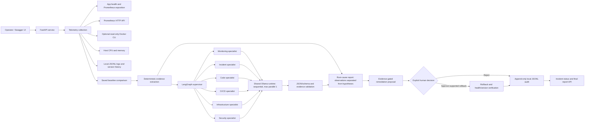

# Architecture and incident flow

## Trust and execution boundaries

- Telemetry and deterministic extraction are the source of verified observations. LLM outputs are hypotheses and recommendations, not measurements or authorization.
- The supervisor queries each selected specialist in a serial loop; Ollama also uses a process-wide lock. `max_parallel_models` remains `1`.
- Rollback is proposed only when the observed baseline, deployment history, and regression signals meet the graph's checks. The workflow pauses at a LangGraph interrupt. Only the explicit approval endpoint resumes it into the rollback node; rejection records an outcome without calling rollback.
- The API writes metadata-only incident events to `logs/incident_audit.jsonl` by default. Audit write failures are reported rather than silently ignored.
- The workflow checkpoint store is in-memory. Keep one application process/worker; outstanding approvals do not survive a process restart.
- The optional GitHub Actions server deployment is a separate CI/CD operation. If its health check fails, the deployment job stops without an automatic image rollback; an operator must inspect and recover the host.

## Observability components

- The FastAPI application exports `calc_*` and process metrics at `/metrics`.
- Prometheus scrapes the app and is queried over its read-only HTTP API.
- Grafana provisions a Prometheus datasource and dashboard from `grafana/`.
- Host CPU/memory is collected using platform APIs.
- Docker container stats are queried via the host Docker CLI when the workflow runs on a host with Docker access. The Compose app does not mount the Docker socket or install the CLI, so Docker telemetry there is explicitly unavailable.
- No Node Exporter or cAdvisor is deployed. Corresponding optional Grafana panels display No Data until an existing compatible Prometheus target supplies those series.
